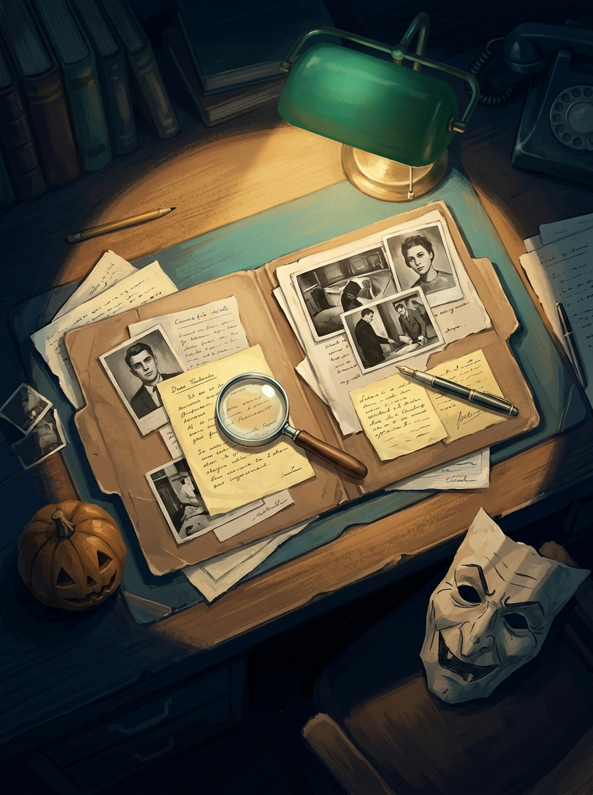
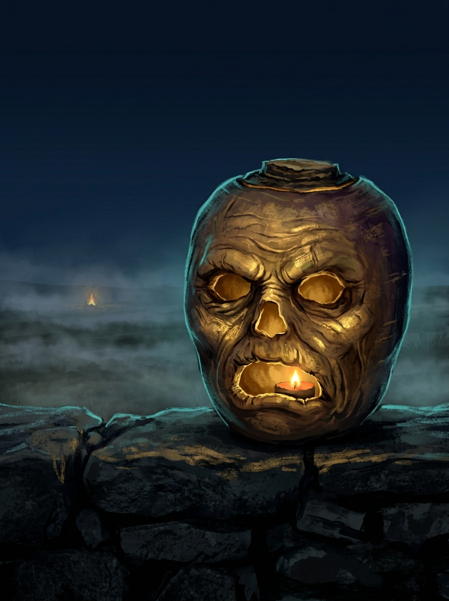
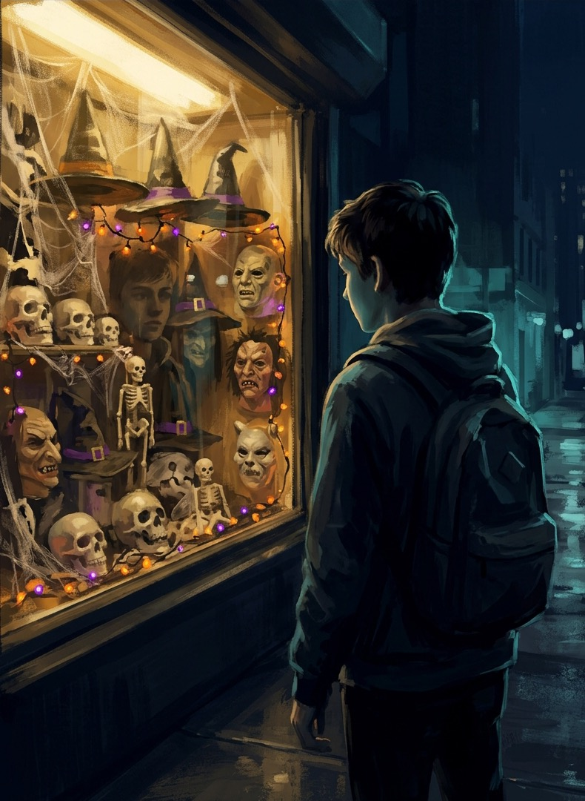
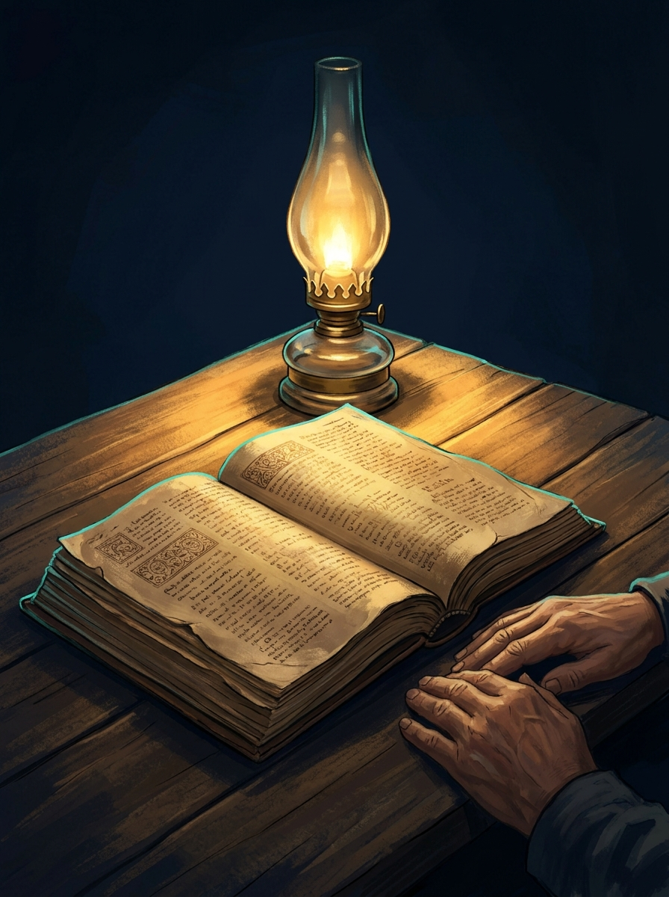
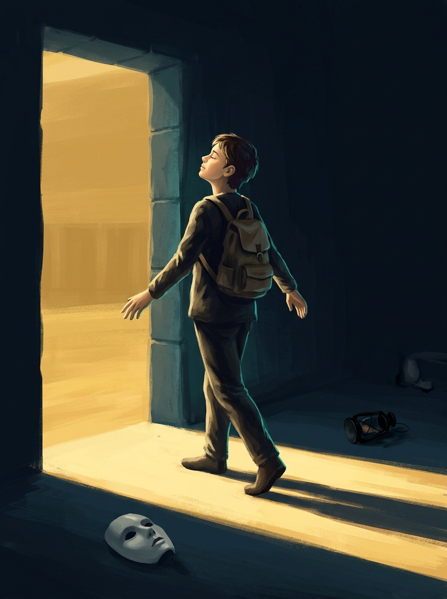

# Дело № 31.10 – промпты для генерации иллюстраций

Сгенерированные картинки класть в `img/` под указанными именами – слоты ниже и слайды подхватят их автоматически, править ничего не нужно.

## Навигация

1. [Папка с делом](#1-папка-с-делом) – `img/case-file.jpg`
2. [Фонарь из репы](#2-фонарь-из-репы) – `img/turnip-lantern.jpg`
3. [Витрина в конце октября](#3-витрина-в-конце-октября) – `img/costume-aisle.jpg`
4. [Писание в свете лампы](#4-писание-в-свете-лампы) – `img/lamp-scripture.jpg`
5. [Из тьмы – к свету](#5-из-тьмы--к-свету) – `img/out-of-darkness.jpg`

## Общий стилевой суффикс

Добавлять в конец каждого промпта (в промптах ниже уже добавлен):

```
Style: cinematic digital painting, dramatic chiaroscuro lighting, semi-realistic
illustration, muted palette of deep navy blue (#0F1B2D) background, warm gold
(#D4A843) key light and teal (#5B8CA8) rim light. Textured brushwork, restrained
detail, not gory, not scary for teenagers, no text, no lettering, no watermark.
Portrait orientation 3:4, dark negative space around the subject.
```

---

## 1. Папка с делом

Слайд 1 – титул «Дело № 31.10» (портрет во всю высоту слева).

```
A detective's desk at night seen from above at an angle. A worn cardboard case
file folder lies open, with old photographs, handwritten notes and a magnifying
glass on top. A single desk lamp casts a warm golden pool of light on the papers.
At the edge of the light, half lost in shadow, a small carved jack-o'-lantern
and a crumpled paper witch mask lie as pieces of evidence. Quiet, investigative
mood, noir atmosphere.
Style: cinematic digital painting, dramatic chiaroscuro lighting, semi-realistic
illustration, muted palette of deep navy blue (#0F1B2D) background, warm gold
(#D4A843) key light and teal (#5B8CA8) rim light. Textured brushwork, restrained
detail, not gory, not scary for teenagers, no text, no lettering, no watermark.
Portrait orientation 3:4, dark negative space around the subject.
```



---

## 2. Фонарь из репы

Слайд «Улика № 1 – Символы» (портрет во всю высоту слева).

```
An old Irish-style lantern carved from a turnip with a crude hollow face, a
small glowing ember inside, standing on a stone wall at night. Behind it a
misty empty moorland with a faint distant bonfire and drifting fog. The lantern
looks ancient and eerie rather than cute, a relic of old pagan custom.
Close-up, low angle, the ember light flickering on the rough turnip skin.
Style: cinematic digital painting, dramatic chiaroscuro lighting, semi-realistic
illustration, muted palette of deep navy blue (#0F1B2D) background, warm gold
(#D4A843) key light and teal (#5B8CA8) rim light. Textured brushwork, restrained
detail, not gory, not scary for teenagers, no text, no lettering, no watermark.
Portrait orientation 3:4, dark negative space around the subject.
```



---

## 3. Витрина в конце октября

Слайд «Улика № 2 – Что прославляется сегодня» (портрет во всю высоту слева).

```
A teenager seen from behind, standing on a city sidewalk in the evening and
looking at a brightly lit shop window full of Halloween merchandise: plastic
skulls, skeletons, witch hats, rubber masks, fake cobwebs, orange and purple
lights. The window glows garishly while the street around is dark and blue.
The figure is still and thoughtful, reflected faintly in the glass.
Style: cinematic digital painting, dramatic chiaroscuro lighting, semi-realistic
illustration, muted palette of deep navy blue (#0F1B2D) background, warm gold
(#D4A843) key light and teal (#5B8CA8) rim light. Textured brushwork, restrained
detail, not gory, not scary for teenagers, no text, no lettering, no watermark.
Portrait orientation 3:4, dark negative space around the subject.
```



---

## 4. Писание в свете лампы

Слайд «Приговор Писания» (портрет во всю высоту слева).

```
An open old Bible lying on a wooden table, lit by a single oil lamp. Warm golden
light spills across the pages and pushes back the surrounding darkness; the
edges of the room fade into deep navy shadow. A pair of hands rests beside the
book, as if someone has just finished reading. Calm, serious, steady mood –
the light is clearly stronger than the dark.
Style: cinematic digital painting, dramatic chiaroscuro lighting, semi-realistic
illustration, muted palette of deep navy blue (#0F1B2D) background, warm gold
(#D4A843) key light and teal (#5B8CA8) rim light. Textured brushwork, restrained
detail, not gory, not scary for teenagers, no text, no lettering, no watermark.
Portrait orientation 3:4, dark negative space around the subject.
```



---

## 5. Из тьмы – к свету

Слайд «Вывод следствия – Тьма не бывает „по приколу"» (портрет во всю высоту слева).

```
A young person stepping out of a dark doorway into a wide stream of warm golden
morning light. Behind them in the shadowy room, scattered on the floor, a
discarded mask and a burnt-out lantern. The figure walks forward with head
lifted toward the light, free and unafraid. Strong contrast between the cold
dark interior and the bright open doorway.
Style: cinematic digital painting, dramatic chiaroscuro lighting, semi-realistic
illustration, muted palette of deep navy blue (#0F1B2D) background, warm gold
(#D4A843) key light and teal (#5B8CA8) rim light. Textured brushwork, restrained
detail, not gory, not scary for teenagers, no text, no lettering, no watermark.
Portrait orientation 3:4, dark negative space around the subject.
```


